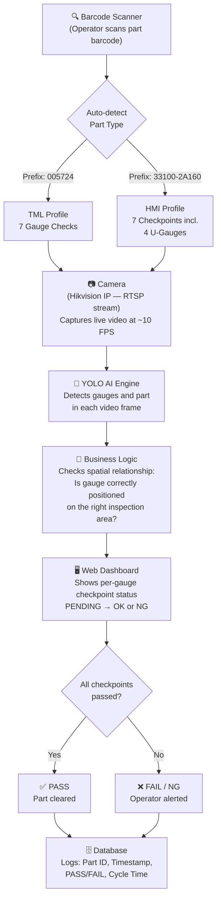

# Chapter 1 — Introduction

**Document:** Firewall DFP6 SOP Compliance System — User Manual  
**Company:** Delphi-TVS Technologies Limited  
**Applies To:** All shop-floor operators, supervisors, and IT/maintenance engineers working with the Firewall DFP6 inspection line.

---

## 1.1 What Is This Software?

The **SOP Compliance Software — Firewall DFP6** is an AI-powered inspection monitoring system deployed on the shop floor of Delphi-TVS Technologies Limited. It uses an overhead IP camera combined with a YOLO (You Only Look Once) computer-vision AI engine to watch the operator in real time and automatically verify that the correct gauges are applied to a part, in the correct inspection areas, before the part is passed.

| Property | Detail |
|---|---|
| **Full Product Name** | SOP Compliance Software — Firewall DFP6 |
| **Developed For** | Delphi-TVS Technologies Limited |
| **Runs On** | Windows Industrial PC (IPC) on the shop floor |
| **User Interface** | Web browser dashboard at `http://localhost:8000` |
| **Core AI Engine** | YOLO (Ultralytics) object detection |
| **Camera** | Hikvision IP camera (overhead, RTSP stream) |

The system **automatically detects and logs PASS or FAIL** for every inspection cycle. It replaces the need for a human supervisor to visually watch every operator action — instead, the AI camera does it continuously and objectively.

> **📝 NOTE:** This software does not replace the existing Firewall line-control software. It runs alongside it as an independent monitoring layer.

---

## 1.2 Purpose and Business Context

### Why This System Exists

Manufacturing SOPs (Standard Operating Procedures) define exactly which gauges must be used and in which order when inspecting a part. If an operator skips a gauge or uses the wrong one, a defective part can pass through — causing quality escapes, warranty claims, and safety risks.

The Firewall DFP6 SOP Compliance System enforces these SOPs automatically, in real time, without relying on manual supervision.

### What It Does

- **Monitors** every inspection cycle via overhead camera.
- **Detects** whether the operator positions each required gauge correctly on the part.
- **Flags** any skipped or incorrect gauge application as **NG (Not Good)** immediately on screen.
- **Logs** every result — part ID, timestamp, PASS/FAIL verdict, and cycle time — to a central database for full traceability and audit.
- **Alerts** in real time so an operator or supervisor can act before the part moves to the next station.

### What It Does NOT Do

- It does not control the production line or conveyors.
- It does not replace the existing Firewall software.
- It does not make mechanical decisions — it only monitors and records.

---

## 1.3 Which Parts Does It Inspect?

The system supports **two inspection profiles**. The correct profile is selected **automatically** when the operator scans a part barcode — no manual switching is needed.

### TML Part Inspection Profile

Activated when the scanned barcode begins with `005724`.

| Checkpoint # | Gauge / Tool Required |
|---|---|
| 1 | Distance Gauge |
| 2 | Pin Gauge |
| 3 | Dia Gauge |
| 4 | M6 |
| 5 | M8 |
| 6 | 11mm Gauge |
| 7 | 13mm Gauge |

All 7 gauge checks must be completed and detected correctly for the part to receive a **PASS**.

### HMI Part Inspection Profile

Activated when the scanned barcode begins with `33100-2A160`.

| Checkpoint # | Gauge / Tool Required | Type |
|---|---|---|
| 1 | 11mm Gauge | Standard |
| 2 | 8mm Gauge | Standard |
| 3 | Outer Seal | Standard |
| 4 | Inlet Go | U-Gauge |
| 5 | Inlet NoGo | U-Gauge |
| 6 | LP Go | U-Gauge |
| 7 | LP NoGo | U-Gauge |

All 7 checkpoints must be completed and detected correctly for the part to receive a **PASS**.

> **📝 NOTE:** Barcodes that do not start with either recognised prefix are silently ignored by the system. The operator will not see any profile change until a valid barcode is scanned.

---

## 1.4 System Overview

The diagram below shows the complete data flow from the moment a barcode is scanned to the final result being written to the database.

---

## 1.5 Key Personnel and Roles

Three types of personnel interact with this system. Their responsibilities are different, and different sections of this manual are written for each audience.

| Role | Who They Are | What They Do in This System |
|---|---|---|
| **Operator** | Shop-floor worker who runs daily part inspections | Scans part barcodes, presents gauges to the camera in the correct sequence, reads the **OK / NG** result on the dashboard screen. **No technical knowledge required.** Refer to Chapter 5 for operator instructions. |
| **Supervisor / Admin** | Team leader or quality supervisor on the line | Can activate an **emergency bypass** (to allow a part through when the system is unavailable), switch inspection profiles manually if needed, and view the inspection log history. Requires the **Admin Password** (set in `config.py`). Refer to Chapter 6. |
| **Maintainer / IT Engineer** | IT staff or maintenance engineer responsible for the IPC and software | Installs and updates the software, manages the database, edits `config.py` to change settings, services the camera and barcode scanner, and troubleshoots hardware/software issues. **This manual is primarily written for this role.** Refer to Chapters 2–4 and 7. |

> **⚠️ WARNING:** The Admin Password is stored in plain text inside `config.py`. It should be changed from the default value (`1234`) before the system goes live. Restrict access to `config.py` to IT/Maintenance personnel only.

---

*End of Chapter 1 — Continue to [Chapter 2: System Requirements & Hardware Setup](./Chapter_02_System_Requirements.md)*
